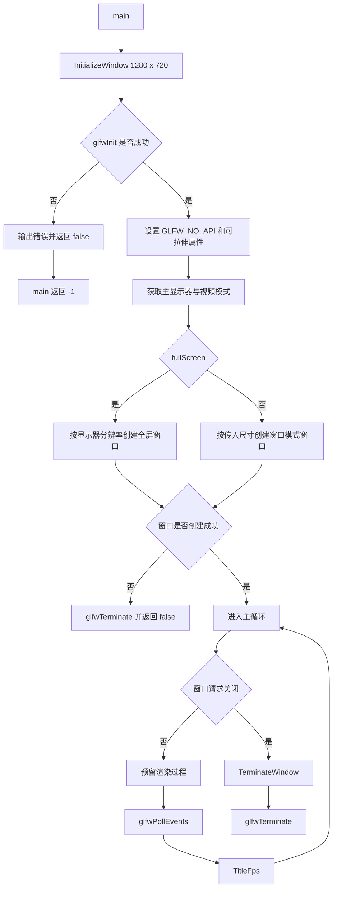

# Ch1-1: 创建 GLFW 窗口

- 对应提交：`df3f2c8` (`Ch1-1 创建GLFW窗口`)
- 目标：完成 Vulkan 程序的窗口创建、事件循环、FPS 标题更新和 GLFW 清理。

## 本次实现

- 新增 CMake 工程，创建 `learnEasyVK` 可执行目标，并配置 GLFW、Vulkan、GLM、stb_image 的头文件、库目录和链接库。
- MSVC 使用 `/std:c++latest` 与 `/utf-8`；启用 `CMAKE_EXPORT_COMPILE_COMMANDS` 以便编辑器获取编译参数。
- `EasyVKStart.h` 统一引入常用标准库、GLM、stb_image 和 Vulkan 头文件。
- 在包含 Vulkan 前定义 `VK_USE_PLATFORM_WIN32_KHR` 和 `NOMINMAX`；在包含 GLM 前定义 `GLM_FORCE_DEPTH_ZERO_TO_ONE`。
- `VKBase.h` 作为 Vulkan 相关代码的基础入口，并预留 `vulkan` 命名空间。
- `GlfwGeneral.hpp` 提供窗口、显示器和标题状态，以及 `InitializeWindow`、`TitleFps`、`TerminateWindow` 三个函数。
- `main.cpp` 创建 `1280 x 720` 窗口，在主循环中轮询事件、更新 FPS，并在窗口关闭后终止 GLFW。

## 运行流程

## 关键知识点

1. **Vulkan 不负责创建窗口。** GLFW 负责窗口、输入和事件处理；`GLFW_NO_API` 告诉 GLFW 不要创建 OpenGL 上下文，窗口将在后续用于创建 Vulkan Surface。

2. **平台宏必须在包含 Vulkan 头文件前定义。** `VK_USE_PLATFORM_WIN32_KHR` 使 Vulkan 暴露 Win32 Surface 相关声明；`NOMINMAX` 避免 Windows 的 `min`、`max` 宏污染标准库。

3. **GLM 的深度范围要与 Vulkan 对齐。** Vulkan 的 NDC 深度区间为 `[0, 1]`，因此要在包含 GLM 前定义 `GLM_FORCE_DEPTH_ZERO_TO_ONE`。

4. **GLFW 返回的数据由 GLFW 管理。** `glfwGetPrimaryMonitor` 与 `glfwGetVideoMode` 返回的对象无需手动释放；视频模式可能随显示设置变化，应在需要时获取。

5. **资源生命周期需要成对处理。** `glfwInit` 成功后，无论窗口创建失败还是程序正常退出，都必须调用 `glfwTerminate`。

6. **事件与 FPS 统计都在主循环中进行。** `glfwPollEvents` 持续处理关闭窗口等系统事件；FPS 以一秒内的帧数除以实际经过时间计算，并按秒更新窗口标题。
