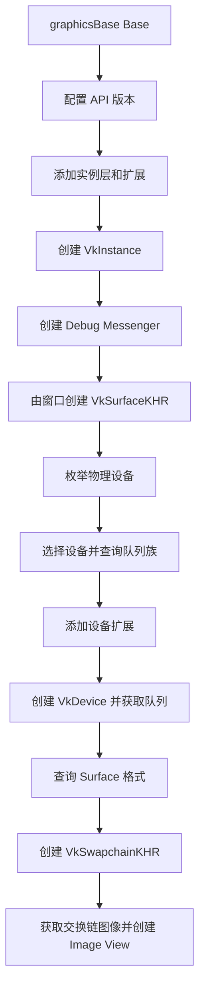

# Ch1-2: 初始化流程

- 对应提交：`89148c4` (`Ch1-2 初始化流程`)
- 目标：建立统一管理 Vulkan 基础对象的 `graphicsBase` 单例，并定义实例、Surface、设备和交换链的初始化接口与顺序。

## 本次实现

- 在 `vulkan` 命名空间新增 `graphicsBase` 单例，集中保存 Vulkan 初始化阶段的状态。
- 提供 `Base()` 访问入口，禁止移动构造，并以 `inline` 静态成员定义唯一实例。
- 定义 Vulkan API 版本状态，以及 `UseLatestApiVersion` 接口。
- 建立实例创建所需的层、扩展、`VkInstance` 状态和管理接口；`AddLayerOrExtension` 会避免重复添加名称。
- 定义 Debug Messenger 与 `VkSurfaceKHR` 的存储和访问接口。
- 定义物理设备枚举、队列族选择、逻辑设备创建及图形、呈现、计算队列的状态与接口。
- 定义交换链格式查询、创建、重建、图像和 Image View 管理所需的状态与接口。

## 运行流程

## 关键知识点

1. **Vulkan 初始化对象存在依赖顺序。** `VkInstance` 是 Debug Messenger 和 Surface 的前提；Surface 用于判断物理设备的呈现支持；选定物理设备及队列族后才能创建逻辑设备和交换链。

2. **单例适合管理全局 Vulkan 上下文。** `graphicsBase` 让窗口、渲染等模块通过同一入口访问唯一的实例、设备、队列和交换链，避免这些基础对象被重复创建。

3. **实例层与扩展要在创建实例前收集。** `instanceLayers` 和 `instanceExtensions` 保存名称指针；`AddLayerOrExtension` 使用 `strcmp` 去重，避免向 Vulkan 传递重复名称。

4. **队列族索引不能用普通零值表示未选择。** 有效索引从 `0` 开始，因此使用 `VK_QUEUE_FAMILY_IGNORED` 作为默认值，才能区分“尚未找到队列族”和“选择了索引 0”。

5. **物理设备、逻辑设备和队列职责不同。** 物理设备代表可用 GPU，逻辑设备代表应用与选定 GPU 的连接，`VkQueue` 则是提交图形、呈现或计算命令的执行队列。

6. **交换链需要保存创建信息以支持重建。** 窗口尺寸变化会使原交换链失效；保存 `VkSwapchainCreateInfoKHR`、交换链图像和 Image View，为后续 `RecreateSwapchain` 提供必要状态。
