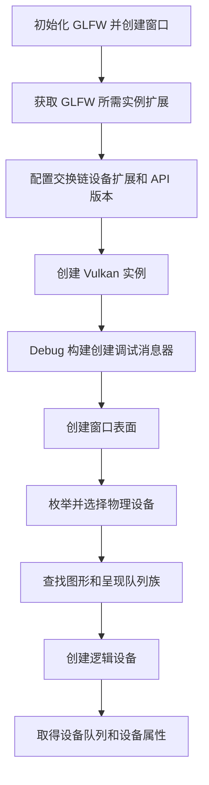

# Ch1-3: 创建 VK 实例与逻辑设备

- 对应提交：`8c59cbb` (`Ch1-3 创建VK实例与逻辑设备`)
- 目标：完成 Vulkan 实例、窗口表面、物理设备、队列族和逻辑设备的基础初始化。

## 本次实现

- 通过 `glfwGetRequiredInstanceExtensions` 获取 GLFW 创建窗口表面所需的实例扩展，并加入 `graphicsBase`。
- 添加 `VK_KHR_swapchain` 设备扩展，获取可用的最高 Vulkan API 版本后创建实例。
- 在 Debug 构建中启用 `VK_LAYER_KHRONOS_validation` 与 `VK_EXT_debug_utils`，并创建调试消息回调。
- 使用 `glfwCreateWindowSurface` 创建 `VkSurfaceKHR`，供后续查询呈现支持能力。
- 枚举实例层和扩展，将不可用的请求项标记为 `nullptr`。
- 枚举物理设备，选择列表中的第一个设备，并查找图形、呈现和计算队列族。
- 基于去重后的队列族创建逻辑设备，取得对应的 `VkQueue`，并缓存物理设备属性与内存属性。

## 运行流程

## 关键知识点

1. **窗口系统扩展由 GLFW 提供。** `glfwGetRequiredInstanceExtensions` 返回当前平台创建 Vulkan 表面所需的实例扩展；该数组由 GLFW 管理，在库终止前有效，调用方不应释放。
2. **实例与设备扩展属于不同层级。** 表面相关扩展在创建 `VkInstance` 时启用，而 `VK_KHR_swapchain` 在创建 `VkDevice` 时启用，不能互换。
3. **扩展函数需要通过实例查询。** `vkCreateDebugUtilsMessengerEXT` 是扩展函数，使用 `vkGetInstanceProcAddr` 取得函数指针后才能调用，并应处理函数不可用的情况。
4. **Vulkan 枚举通常采用两次调用。** 先以空数组取得数量，再分配容器并传入数据指针，以获取实例层、扩展和物理设备等可变长度列表。
5. **队列族应按能力匹配并去重创建。** 图形、呈现和计算能力可能来自同一个或不同队列族；创建逻辑设备时只为每个唯一队列族准备一份 `VkDeviceQueueCreateInfo`。
6. **表面决定呈现队列的判断。** 仅有 `VkSurfaceKHR` 后才能通过 `vkGetPhysicalDeviceSurfaceSupportKHR` 验证某个队列族是否支持向该窗口呈现。
