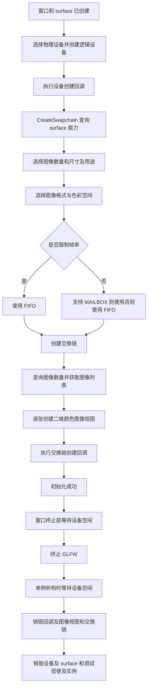

# Ch1-4: 创建交换链

- 对应提交：`75b6436` (`Ch1-4 创建交换链`)
- 目标：在窗口与逻辑设备初始化后创建交换链及图像视图，建立相关资源的重建与清理流程。

## 本次实现

- 在 `InitializeWindow()` 中调用 `CreateSwapchain(limitFrameRate)`，创建失败时返回 `false`。
- 查询 surface 能力，选择图像数量、尺寸、变换、透明通道处理方式及图像用途；尺寸未指定时，将默认的 1280 × 720 限制在支持范围内。
- 实现 surface 格式查询与选择，优先尝试 RGBA8、BGRA8 的 UNORM 格式搭配 SRGB 非线性色彩空间，失败则使用首个支持组合。
- 默认使用 FIFO 呈现模式；关闭帧率限制时优先选择受支持的 MAILBOX，否则保留 FIFO。
- 创建交换链，通过两次查询取得其图像，为每张图像创建二维颜色图像视图。
- 提供 `RecreateSwapchain()`，重新查询尺寸、等待相关队列空闲、释放旧图像视图并创建新交换链；零尺寸时返回 `VK_SUBOPTIMAL_KHR`。
- 添加设备和交换链的创建、销毁回调，以及 `WaitIdle()`、析构清理和 `RecreateDevice()`；窗口终止前等待设备空闲。

## 运行流程

## 关键知识点

1. **交换链参数受 surface 能力约束。** 图像数量在允许时采用最小数量加一；`maxImageCount` 为 0 表示没有数量上限。`currentExtent` 未指定时才使用受最小、最大尺寸约束的默认窗口大小。
2. **图像格式与色彩空间需要成对选择。** `SetSurfaceFormat()` 同时匹配两者；格式为 `VK_FORMAT_UNDEFINED` 时只匹配色彩空间。交换链已经存在时，成功设置格式会触发重建。
3. **呈现模式影响显示节奏。** FIFO 按刷新节奏排队呈现；MAILBOX 用较新的待呈现图像替换旧图像。本次通过 `limitFrameRate` 选择模式，尚未实现提交或呈现画面的渲染循环。
4. **交换链图像与图像视图的所有权不同。** `vkGetSwapchainImagesKHR()` 返回交换链管理的图像，应用无需单独销毁这些图像；应用创建的 `VkImageView` 则需要显式释放。这里的视图只覆盖颜色方面、一个 mip 层级和一个数组层。
5. **重建需要同步，也需要管理旧资源。** `RecreateSwapchain()` 等待图形队列以及不同的呈现队列空闲，再释放旧视图，并通过 `oldSwapchain` 传入旧句柄。传入旧句柄不会自动销毁旧交换链，本次代码仍留有清理占位；接口也尚未接入窗口尺寸变化的自动触发流程。
6. **生命周期回调用于管理依赖资源。** 销毁回调先于基础对象销毁执行，创建回调在基础对象创建成功后执行。`RecreateDevice()` 接受等待时的 `VK_ERROR_DEVICE_LOST` 并继续重建设备，但只重建设备，交换链需要另行创建。
