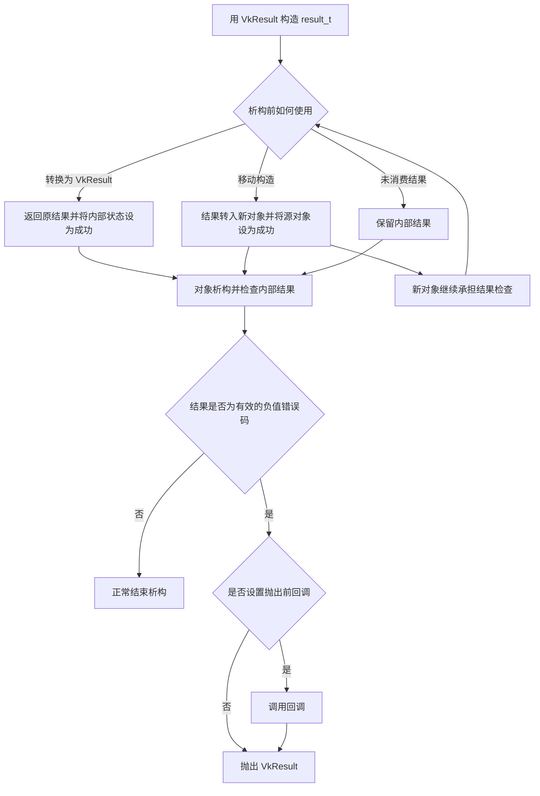

# Ch2-0: 代码整理及一些辅助类

- 对应提交：`e4a64e8` (`Ch2-0 代码整理及一些辅助类`)
- 目标：为 Vulkan 对象封装准备数组视图、句柄操作和返回值处理工具，并整理实例创建中的调试分支。

## 本次实现

- 在 `Src/EasyVKStart.h` 中新增 `arrayRef<T>`，支持从单个对象、原生数组、指针与元素数量构造，提供索引、迭代及指针和数量访问。
- 新增 `ExecuteOnce(...)` 宏：首次经过时设置局部静态标记，后续经过时直接返回指定值，用于控制函数中宏之后的代码。
- 在 `Src/VKBase.h` 中新增句柄销毁、移动、隐式类型转换及地址访问宏，为后续 Vulkan 资源封装提供公共操作。
- 新增 `result_t`，提供析构时抛出未消费错误、`[[nodiscard]]` 弃值提醒和直接使用 `VkResult` 三种编译分支；当前通过 `VK_RESULT_THROW` 启用第一种。
- 新增 `vulkan::outStream`，引用 `std::cout`；新增可选的 `result_t::callback_throw`，用于在抛出结果码前执行回调。
- 用由 `NDEBUG` 决定的 `ENABLE_DEBUG_MESSENGER` 常量和 `if constexpr`，替换 `CreateInstance()` 内两处调试预处理分支，保留验证层、调试扩展和消息接收器的条件启用行为。

本次辅助类型和宏尚未接入现有业务调用，原有接口仍返回 `VkResult`。标准库连续容器构造、移动赋值宏和弹窗日志方案仅保留为注释示例。

## 运行流程

下图描述当前启用的异常分支中，`result_t` 被使用时的生命周期；它尚未成为现有初始化接口的返回值处理流程。

## 关键知识点

1. **数组视图不拥有数据。** `arrayRef<T>` 只保存指针和元素数量，不复制或释放元素，底层数据必须在使用期间有效。索引不检查边界；`const arrayRef<T>` 也不代表元素只读，要约束元素修改应使用 `arrayRef<const T>`。
2. **移动句柄要转移销毁责任。** `MoveHandle` 复制句柄后清空源句柄，`DestroyHandleBy` 检查非空、调用销毁函数并清空句柄。它们依赖封装类提供 `handle`，销毁宏还依赖有效的逻辑设备；`Address()` 返回只读句柄指针，不能直接作为创建 API 的输出参数。
3. **消费结果与处理错误并不等价。** `result_t` 转换为 `VkResult` 时会清除内部状态，即使调用者之后忽略错误，也不会再由该包装对象抛出。对有效的 Vulkan 结果码，析构检查放行成功和正值状态码，对仍保留的负值错误码调用可选回调后抛出。
4. **析构抛异常影响栈展开。** `result_t` 的析构函数声明为 `noexcept(false)`；若在另一个异常的栈展开期间再次抛出，会导致 `std::terminate`。移动构造将源对象重置为成功，使结果检查责任转移到目标对象。
5. **局部静态标记不等于线程安全的一次执行。** `ExecuteOnce` 的标记属于宏展开位置，并非每个对象各有一份；宏在后续代码执行前就置位，后续失败也不会自动重试。对标记的检查和写入没有同步，不能替代 `std::call_once`。
6. **常量条件保留代码的语法可见性。** `ENABLE_DEBUG_MESSENGER` 在未定义 `NDEBUG` 时为真，`if constexpr` 决定是否执行调试初始化。相比移除源码的预处理分支，这让两个分支都保留在 C++ 源码中；在当前非模板函数里，被丢弃的分支仍需通过语义检查。
